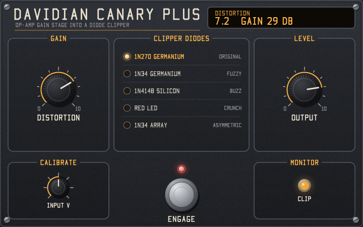

# Davidian Canary Plus

A Davidian LV2 circuit model of an op-amp gain stage driving a diode clipper. Mono, 64-bit Windows. The name, panel and lettering are original, with no branding from any commercial pedal.

## Build and test

```
build.bat
build-test\test_dsp.exe build\canary-plus.lv2
build-test\ui_check.exe build\canary-plus.lv2
build-test\ui_render.exe panel.bmp
```

`build.bat` needs Visual Studio's C++ tools. It puts the bundle in `build\` and the test programs in `build-test\`, so the LV2 parser sees only the bundle. `ui_check.exe` hosts the GUI in a window and drives it with mouse messages. `ui_render.exe` draws the panel to an image without opening a window.

To check the bundle with the lilv LV2 parser before installing:

```
set LV2_PATH=%CD%\build
build-test\lilv_check.exe
```

## Download

A ready-built bundle for 64-bit Windows is in [`release/canary-plus-1.0.0-win64.zip`](release/canary-plus-1.0.0-win64.zip). It was built with `build.bat` from the commit tagged `v1.0.0` and passes all the tests above.

The zip holds one `canary-plus.lv2` folder:

- The plugin DLL
- The GUI DLL
- The two `.ttl` files
- `LICENSE.txt`
- `AI-DISCLOSURE.txt`

Unzip it into an LV2 folder as described below.

This repository is the source code for that build, as the GPL requires. If you pass the zip on, pass on a link to this repository with it.

## Install

Copy the whole `canary-plus.lv2` folder, from the zip or from `build/` after building, into one of the standard LV2 folders:

- Windows: `%APPDATA%\LV2` (current user) or `%COMMONPROGRAMFILES%\LV2` (all users)
- Linux: `~/.lv2` (current user) or `/usr/local/lib/lv2` (all users)
- macOS: `~/Library/Audio/Plug-Ins/LV2`

If your host doesn't scan that folder, add it to the host's LV2 search path or set the `LV2_PATH` environment variable. Close the host before copying and restart it afterwards. Replace any older copy instead of keeping two: when two bundles have the same URI, the loader uses one and ignores the other.

Look for **Davidian Canary Plus** in your host's plugin list. The plugin URI is `urn:davidian:canary-plus`.

On Windows, `install.bat` copies the bundle to `%APPDATA%\LV2` for you.

## GUI



The GUI uses the Davidian house style (`src/ui/style.h`, `font.h` and `canvas.h`). It has no dependencies: it draws with its own software renderer and stroke font in a Win32 window (`ui:WindowsUI`). The source also has an X11 window layer, but it hasn't been built or tested.

- Drag a knob up or down to turn it. Hold Shift for fine control. Double-click resets it, and the mouse wheel works too.
- Click a diode row to select it, or use the mouse wheel over the list.
- Click the footswitch to engage or bypass. Its red LED shows the state. It drives the host bypass port (`enabled`).
- The amber CLIP lamp shows how hard the diodes are clipping, from the plugin's `clip` output port. It stays dark for a clean signal, even with germanium diodes.
- The readout shows the last control you touched. Distortion also shows the gain stage's mid-band gain, and Output shows its level in dB.

The panel name, lettering and layout are original, with none of the original pedal's branding or artwork.

## Controls

| Control | Range | Default | Notes |
|---|---|---|---|
| Distortion | 0–1 | 0.5 | 1M pot; sets gain (6–46.6 dB) and low cut together |
| Output | 0–1 | 0.8 | 10k volume pot |
| Diodes | 5 choices | 1N270 | The schematic's alternatives |
| Volts at 0 dBFS | 0.1–10 | 1.0 | Voltage a full-scale digital signal represents. Higher drives the circuit harder and comes out quieter; lower does the reverse |
| Enabled | on/off | on | Crossfaded bypass, delayed to match the effect |
| Clip (output) | 0–1 | | Diode clipping amount for the GUI lamp, with a 150 ms release |

Latency is 32 samples, reported to the host, at every sample rate.

## Code layout

| File | Contents |
|---|---|
| `src/ports.h` | Port numbers and knob curves, shared by the plugin and GUI |
| `src/input_hp.h` | Stage 1: input coupling |
| `src/gain_stage.h` | Stage 2: 741 gain stage |
| `src/clipper.h` | Stages 3–4: output coupling, diodes, diode values, clip amount |
| `src/oversampler.h` | Oversampling filters |
| `src/plugin.c` | LV2 entry points, controls, bypass |
| `src/ui/panel.h` | GUI layout, drawing and mouse handling |
| `src/ui/ui_lv2.c` | LV2 GUI entry points and the window layer |
| `src/ui/style.h`, `font.h`, `canvas.h` | Davidian house style: palette, stroke font, renderer |
| `bundle/` | LV2 metadata, `AI-DISCLOSURE.txt` and `LICENSE.txt` |
| `LICENSE` | GPL-3.0 licence text |
| `src/version.rc`, `src/ui/version.rc` | Windows file details for the DLLs, including the AI disclosure |
| `test/test_dsp.c` | Tests that load the built DLL |
| `test/ui_check.c`, `test/ui_render.c` | GUI tests |
| `test/lilv_check.c` | Checks the metadata with the lilv LV2 parser |

## Values not from the schematic

These are estimates to tune by ear or against a real pedal:

- Diode `Is` and `n` (`src/clipper.h`)
- 741 gain-bandwidth, slew rate and output swing (`src/gain_stage.h`)
- Pot taper (`TAPER_BASE` in `src/ports.h`)
- The 5 Hz output DC blocker (`src/plugin.c`), which stands in for the next device's input capacitor

## AI disclosure

This plugin was written with AI assistance. Claude (Anthropic) generated the DSP code, GUI, tests, build scripts and documentation. The author directed the work and tested it by ear in Ardour. Every build carries this disclosure:

- `AI-DISCLOSURE.txt` in the bundle folder
- The plugin description in `canary-plus.ttl`, which hosts may show
- The Comments field of both DLLs (right-click > Properties > Details)

## Licensing

This project is free software under the **GNU General Public License, version 3 or later** (GPL-3.0-or-later). The full text is in `LICENSE`, and the bundle carries a copy as `LICENSE.txt`.

- **Where it's declared:** each source file starts with an SPDX line. The plugin's `.ttl` declares the licence with `doap:license`, and the Comments field of both DLLs names it too.
- **If you share the bundle:** include `LICENSE.txt` and make the matching source code available as well. A link to the source, or a zip of this folder next to the bundle, is enough.
- **No copyright notices:** the files carry no copyright lines, at the author's choice. The GPL only asks for them as a recommendation. The licence text itself keeps the Free Software Foundation's line, because the GPL allows only verbatim copies of itself.
- **No third-party code is included.** `src/lv2_abi.h` declares the LV2 interface by hand from the public specification, so the ISC-licensed LV2 headers aren't copied. The DLLs link only Windows system libraries and the statically linked Microsoft C runtime, which Visual Studio's licence lets you redistribute in a compiled program.
- **Test tools:** `test/lilv_check.c` loads Ardour's `lilv-0.dll` (ISC licence) while it runs. It's a local test tool and isn't part of the bundle.
- **Reference images:** `schematic.gif` and `doubler_layout.png` are other people's drawings, kept here for reference only. Neither is part of the bundle, so don't redistribute them with it.
- **AI-generated code:** in some places, including the US, material generated by AI without enough human creative input may not be protected by copyright. Where that applies, the GPL covers the parts that are protected, and anyone can use the rest anyway.
